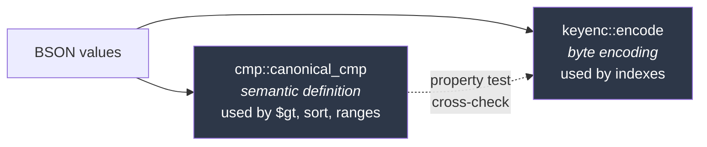
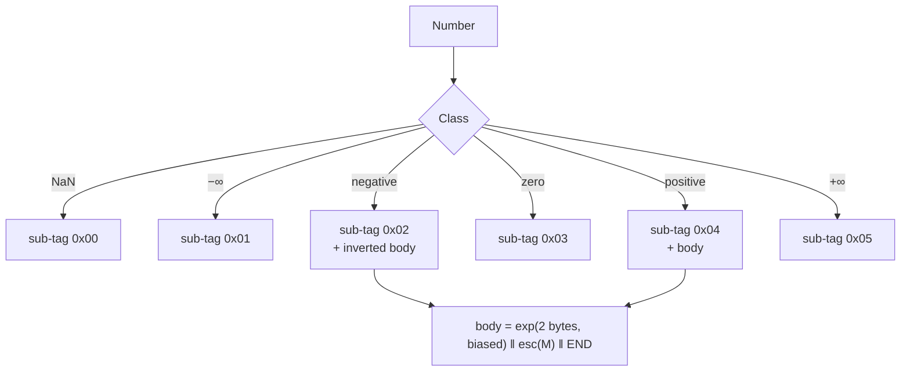

# Key Encoding

[← Documentation index](README.md)

The most subtle component in KimmyDB, and the one whose failure mode is worst:
it does not crash, it silently returns wrong query results.

Implemented in `kimmy-core/src/keyenc.rs` and `kimmy-core/src/cmp.rs`.

---

## The problem

Secondary indexes are redb key ranges, and redb compares keys with `memcmp`. So
an index is only correct if the byte encoding of a value sorts *exactly* the way
the value itself sorts:

```
encode(a).cmp(encode(b))  ==  canonical_cmp(a, b)     for all a, b
```

Get this wrong and nothing fails loudly. Range scans quietly miss documents,
`$gt` returns the wrong set, sorts come out shuffled. The bug surfaces as "the
database gave me the wrong answer", weeks later, on someone else's data.

That risk shapes everything below.

---

## Two independent implementations

There are deliberately **two** implementations of ordering:



`keyenc` does not call `canonical_cmp`, and `canonical_cmp` does not call
`keyenc`. A property test asserts they agree over 2,000 generated value pairs
concentrated on type boundaries, numeric limits, NUL bytes, and empty
composites.

Writing the encoder to delegate to the comparator would have been less code and
strictly worse: a single implementation cannot catch its own bit-manipulation
errors. An oracle is the point.

---

## Type ordering

Values of different types never compare by content. A leading tag byte decides,
and the tags are chosen so cross-type ordering falls out of that byte alone.

| Tag | Type | Tag | Type |
|---|---|---|---|
| `0x01` | MinKey | `0x80` | Boolean |
| `0x10` | Null / Undefined | `0x90` | DateTime |
| `0x20` | Numbers | `0xA0` | Timestamp |
| `0x30` | String / Symbol | `0xB0` | Regex |
| `0x40` | Document | `0xC0` | DbPointer |
| `0x50` | Array | `0xD0` | JavaScript |
| `0x60` | Binary | `0xE0` | JS with scope |
| `0x70` | ObjectId | `0xF0` | MaxKey |

This is MongoDB's canonical order, so queries written against Mongo behave the
same way here. Gaps between tags are intentional — a type can be slotted in
later without renumbering.

---

## Numbers: the hard part

All numeric types share one tag, because `5i32`, `5i64`, `5.0f64` and
`Decimal128("5.00")` must compare equal *and encode identically*. If they
encoded differently, an index lookup for `5` would miss a document that stored
`5.0`. A number is its **exact value**: a `Decimal128` is `±c × 10^e`, every
member of a cohort (`1.0`, `1.00`, `10E-1`) is one value, and `Decimal128("0.1")`
is not the double `0.1`, whose exact value is slightly above one tenth
([ADR-238](decisions.md)).

### Why not encode through `f64`?

The obvious approach — convert everything to a double and bit-twiddle for
order — loses above 2^53:

```
9_007_199_254_740_992  as f64  →  9007199254740992.0
9_007_199_254_740_993  as f64  →  9007199254740992.0    ← same!
```

Two distinct `i64` values would collapse into one index entry. Anyone using
large integer ids gets silently wrong results. A `Decimal128` makes it worse:
two decimals that differ in their 34th digit round to one double.

### The exact representation

Every finite non-zero number is written as

```
value = ±M × 2^(exp − 127),    M the first 128 bits of the binary expansion, top bit set
```

so `exp = ⌊log2 |value|⌋`, exactly. For an `Int32`, `Int64` or `Double` the
expansion has at most 64 significant bits, so `M` is the 64-bit normalised
significand followed by 64 zero bits and nothing is lost. For a `Decimal128`
the expansion can be far longer than 128 bits, or never end (`0.1` is
`0.000110011001100…` in binary), so `M` is its first 128 bits and a mark says
whether anything nonzero follows. Equal values have equal
expansions, so they get equal bytes whatever their type or spelling.



The sub-tags are ordered so the leading byte alone sorts
`NaN < −∞ < negatives < 0 < positives < +∞` — matching Mongo, which sorts NaN
below all numbers. Every NaN is one NaN (a `Decimal128` NaN with any sign,
signalling bit or payload included), every infinity of a sign is one, and zero
in any spelling (`-0.0`, `Decimal128("-0")`, `0E-100`, a non-canonical
coefficient) is `20 03`. Those keys are two bytes.

For a finite non-zero value the body is:

```
body   =  exp (2 bytes)  ‖  esc(M)  ‖  END
exp    =  ⌊log2 |value|⌋ + 32768, big-endian
M      =  the 128 bits as 16 bytes, trailing 0x00 bytes stripped (at least one: the top byte is ≥ 0x80)
esc(M) =  M with every 0x00 written 00 FF        (the string framing, below)
END    =  00 00   when every bit of the expansion after the first 128 is zero  (the key is exact)
          00 01   when some bit after the first 128 is nonzero                 (the value is above M)
```

Larger exponent → larger magnitude; equal exponents compare by `M`, byte by
byte, as a string does. **`END` is a property of the value and of nothing
else**: not of the digit count, the sign of the exponent or the type.
`Decimal128("1267650600228229401496703205376E+22")` (`c = 2^100`) equals the
double `2^122 · 5^22`; its integer significand `c · 5^22` is 152 bits long, but
every bit after the 128th is zero, so it ends `00 00` and its key is the
double's, byte for byte. The exponent field holds every decimal: the largest,
`9.99…E+6144`, has `exp` 20,413, and the smallest, `1E-6176`, −20,517.

**Negatives invert every byte of the body**, `END` included. For a
*prefix-free* code — which this is, see below — flipping all bytes exactly
reverses order, which is what turns "larger magnitude" into "smaller value".

**Sizes.** Zero and the specials are 2 bytes; `Int64(5)` is
`20 04 80 02 A0 00 00`, 7 bytes. An interior zero byte costs an escape, so a
size is a bound and not an average: `Double(1 + 2^-52)` is 18 bytes,
`Int64(2^62 + 1)` 20, and `Decimal128("0.1")`, whose window is `CC` sixteen
times and is truncated, 22 (`20 04 7F FC CC…CC 00 01`). The longest key a
decimal can have is 36 bytes: a window of `80`, fourteen zero bytes and a last
byte, truncated. Through 0.50.x a finite number's key was always 12 bytes, a
fixed 8-byte mantissa with no escape and no end; every number key on disk
changed in 0.51.0, which is what storage schema 5's migration re-keys and
rebuilds.

### Why 128 bits suffice: the order, in two lemmas

Read each positive finite value as `M × 2^(exp − 127)` with `M` the first 128
bits of its significand. Two values with different `exp` are ordered by it.
With the same `exp` they are ordered by their expansions, and the key shows
only the first 128 bits and the mark, so the question is whether two different
values can share those.

**Lemma 1 (decimal against decimal).** If `x ≠ y` are positive `Decimal128`
values, then `|x − y| / max(x, y) ≥ 10^-34`.
*Proof.* Write `x = X·10^a` and `y = Y·10^b` with `1 ≤ X, Y < 10^34` and
`a ≥ b`, and measure both in units of `10^b`: `A = X·10^(a−b)` and `B = Y` are
positive integers, `B < 10^34`, and `10 | A` when `a > b`. If
`max(A, B) ≤ 10^34`, then `|A − B| ≥ 1` gives a ratio of at least
`1/max(A, B) ≥ 10^-34`. Otherwise `max(A, B) = A > 10^34`, so `a > b`, and `A`
is a multiple of 10 above `10^34`, so `A ≥ 10^34 + 10`; the ratio is
`1 − B/A ≥ 1 − (10^34 − 1)/A`, which grows with `A`, and at `A = 10^34 + 10` it
is `11/(10^34 + 10) > 10^-34`. ∎
Two values whose first `n` significand bits agree differ by less than
`2^-(n−1)` of the larger, so `2^-(n−1) > 10^-34`, which forces `n ≤ 113`
(`34 · log2 10 ≈ 112.95`): **two distinct decimals share at most 113 leading
bits**, so equal 128-bit windows mean equal values, and 128 leaves a margin of
15 bits. (The design's draft said `1/(2·10^34)` and 114 bits; the bound is one
bit tighter, and `adjacent_decimals_share_at_most_113_bits` reaches 113 and
never 114.)

**Lemma 2 (decimal against a binary value).** An `Int32`, `Int64` or `Double`
has at most 64 significant bits, so its window is its whole expansion and it
ends `00 00`. A decimal with the same window is either equal to it (every later
bit zero, so it ends `00 00` too, and the keys are equal) or above it by a tail
after bit 128 (it ends `00 01`, which sorts above `00 00`). It is never below:
truncation only discards bits. Lemma 1 does not cover this case, since a
34-digit decimal can lie within `2^-128` of a double without equalling it, and
such pairs exist: `decimals_beside_doubles_order_by_their_mark_alone`
constructs them rather than searching for them.

**Three keys that share a window, in order:** the exact `M` (`… 00 00`) <
a value just above `M` (`… 00 01`) < any longer exact value, which continues
with `00 FF` (a zero byte) or a nonzero byte, both above `00 01`. So a key that
ends is never a prefix of one that goes on, and both directions of every
comparison come out right.

### How the encoder takes the window

The binary types read `M` and `exp` from the same decomposition as before. A
`Decimal128` takes its window from a table of the first 192 bits of each power
of five and a 320-bit product, with a stated error bound, and falls back to
exact big-integer arithmetic when the bits just below the cut lie within that
bound of a carry. `END` has a closed form: for `e ≥ 0` it is exact exactly when
the integer `c · 5^e` has no nonzero bit after its first 128; for `e < 0` the
expansion ends exactly when `5^-e` divides `c`, which no `e ≤ -49` allows. The
encoder shares no code with the comparator but the small big integer, and the
tests hold it to a third key function written on exact rationals.

### Worked example: 5 as four types

| Input | Value | exp | `M` | Bytes |
|---|---|---|---|---|
| `Int32(5)` | 5 × 2⁰, `lz`=61 | `63−61 = 2` | `A0` then zeros, stripped | `20 04 80 02 A0 00 00` |
| `Int64(5)` | identical | `2` | `A0` | identical |
| `Double(5.0)` | 5×2⁵⁰ × 2⁻⁵⁰, `lz`=11 | `−50−11+63 = 2` | `A0` | identical |
| `Decimal128("5.00")` | 500 × 10⁻² | `2` | `A0`, and the expansion ends | identical |

All four produce the same bytes, which is exactly what an index needs.

### Decimal128 was refused, through 0.50.x

**Amended in 0.51.0.** Until then `encode()` refused a `Decimal128` (ADR-005):
the 8-byte form could not hold one exactly, and the comparator ranked one equal
to every other number, because it had nothing exact to compare with. A
`Decimal128` could not be an index key or an `_id`; a document holding one at
an indexed path was filed *unkeyed* and rechecked on every scan, and one at a
partial filter's path in an undecidable run ([ADR-185](decisions.md)). The
refusals covered the caller's operands and not the stored value, which is why
`$ne` could never exclude a document holding one. Storage schema 5 gave the
decimal its exact place in the order and in the key, so a `Decimal128` is
compared, sorted and indexed by value, and can be an `_id`
([Indexes](indexes.md#a-decimal128-at-a-filtered-path),
[Query language](query-language.md#3-comparisons-do-not-cross-type-groups)).
`$convert` to `decimal` and `$toDecimal` stay refused, for a reason of their
own: converting a double needs a rounding rule ([Deviations](deviations.md)).

---

## Strings and prefix-freeness

Byte strings are NUL-escaped and terminated:

- `0x00` in the input → `0x00 0xFF`
- terminator → `0x00 0x00`

The terminator sorts *below* an escaped NUL, which is what makes a string sort
before its own extensions:

```
"ab"      →  61 62 00 00
"ab\0c"   →  61 62 00 FF 63 00 00
                    ^^ 00 < FF  ✓
"abc"     →  61 62 63 00 00
                 ^^ 62 < 63  ✓
```

### Prefix-freeness, and why it matters

**No encoding is ever a proper prefix of another.** Fixed-width encodings share
a length; variable-width ones are terminated; documents and arrays end with an
explicit element terminator that cannot appear where an element starts.

Two things depend on this:

1. **Compound keys need no separators.** `encode_compound` is plain
   concatenation, and the leading component still dominates the ordering.
2. **Byte inversion reverses order exactly.** For prefix-free codes this holds;
   for codes with prefixes it does not (if `A` is a prefix of `B` then `A < B`,
   but `flip(A)` is still a prefix of `flip(B)` so `flip(A) < flip(B)` — order
   preserved, not reversed). This is what makes negative numbers work, and what
   will make descending index fields work when indexes land.

---

## Composite values

Documents and arrays are encoded recursively with explicit framing:

```
Array:     0x50  [0x01 <element>]*  0x00
Document:  0x40  [0x01 <key> <value>]*  0x00
```

An element is introduced by `0x01`; the composite ends with `0x00`. Since
`0x00 < 0x01`, a shorter sequence sorts before a longer one that shares its
prefix — matching "compare elementwise, then by length".

Documents compare key-then-value, pair by pair, which is Mongo's rule.

---

## Invariants under test

| Invariant | Test |
|---|---|
| Encoding order matches semantic order | `encoding_order_matches_canonical_order` — 2,000 cases |
| Equal values encode identically | `equal_values_encode_identically` |
| Compound keys order lexicographically by component | `compound_encoding_matches_lexicographic_component_order` |
| Numeric ordering is correct | `numeric_order_matches_an_independent_oracle` — 4,000 cases |
| Ordering is a total order | `ordering_is_transitive`, `ordering_is_antisymmetric` |
| Number keys equal an exact-rational reference key and order by value | `number_keys_are_the_reference_keys_and_order_by_value` — 2,500 cases |
| Every member of a cohort has one key | `cohort_members_have_one_key` |
| Lemma 1: distinct decimals share at most 113 leading bits | `adjacent_decimals_share_at_most_113_bits`, `neighbouring_decimals_keep_the_margin` |
| Lemma 2: a decimal beside a double is ordered by its mark alone | `decimals_beside_doubles_order_by_their_mark_alone` |
| The three keys that share a window order as stated | `the_layout_orders_the_three_kinds_of_key_that_share_a_window` |
| A number key delimits itself, ascending and descending | `a_number_key_delimits_itself`, `number_keys_are_prefix_free_in_both_directions` |
| The layout, the sizes and the A1 pair, in bytes | `the_layout_in_bytes_and_sizes`, `the_a1_pair_has_equal_bytes` |

### The oracle, and the gap it closed

The cross-check above has a hole for numbers: `keyenc` encodes the binary
types *through* `cmp::decompose`, so the two implementations are **not**
independent for those values. A bug in the decomposition would corrupt both
identically and the property test would happily pass.

So numeric ordering is additionally checked against an oracle that shares no
code with either — comparing integers as integers, and mixed int/double pairs by
splitting the double into floor plus remainder, never rounding the integer.
Since 0.51.0 there are three implementations for every number: the comparator
(an exact cross-multiplication on a small big integer), the encoder (a window
from a table of powers of five, an exact fallback, and the closed-form mark),
and a key function in the tests written on exact rationals with neither. The
encoder is checked against both, and its fast window against its exact one.

### Mutation testing

A passing property test proves nothing if it cannot detect a bug. Two faults
were injected deliberately and both were caught with minimal counterexamples:

| Injected fault | Caught by | Counterexample |
|---|---|---|
| Removed negative-number byte inversion | encoder cross-check | `Int32(-1)` vs `Int32(-2)` |
| Changed exponent normalization `63 → 62` | numeric oracle | `Double(2^53)` vs `Int64(2^53)` |

---

## Comparison semantics beyond the encoder

`canonical_cmp` defines total order across *all* values, but query comparison
adds a rule on top: **`$gt`/`$lt` do not cross type groups.**

```javascript
{ a: { $gt: 1 } }        // does NOT match { a: "text" }
```

Even though strings sort after numbers canonically, Mongo does not report that a
string is greater than a number, and neither does KimmyDB. Sorting uses the full
canonical order; comparison operators are type-restricted. See
[Query Language](query-language.md).

---

## Next

- [Storage](storage.md) — where these keys are used
- [Query Language](query-language.md) — the comparison rules built on top
- [Testing](testing.md) — the wider testing approach
