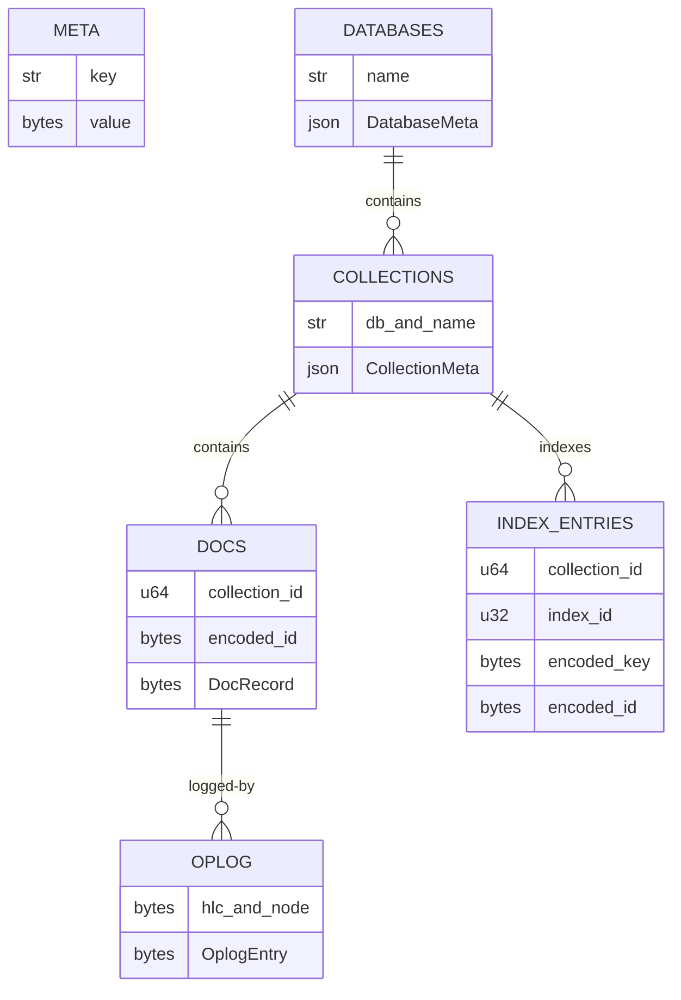
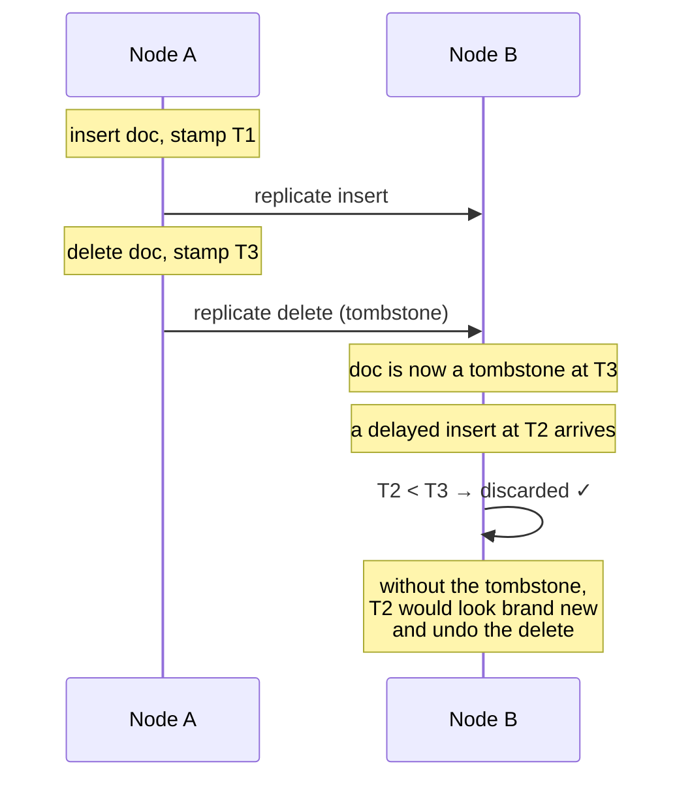

# Storage

[← Documentation index](README.md)

How KimmyDB lays out bytes on disk. Implemented in `kimmy-storage`.

---

## Engine

Everything lives in a single [redb](https://github.com/cberner/redb) file,
`kimmy.redb`, inside the configured data directory. redb is a pure-Rust
embedded ACID B-tree store with MVCC snapshots — one writer, many concurrent
readers.

```
/var/lib/kimmy/
├── kimmy.redb        documents, oplog, users, node identity — everything
├── kimmy.format      the schema, the redb version and file format, and the
│                     version that wrote the store; read before each open
│                     ([Operations](operations.md#rolling-back-and-kimmyformat))
├── kimmy.last-exit   how the last run ended; written on the way out, read and
│                     removed by the next start ([Operations](operations.md#what-a-shutdown-logs-and-what-a-start-says-about-the-last-one))
├── kimmy.last-start  when the current run reached serving and what verdict it
│                     started from; advisory, read by the next start to judge
│                     probation ([Operations](operations.md#a-member-that-yields-a-class-of-work)),
│                     ignored by 0.43.0
└── kimmy.swim-incarnation
                      this member's last SWIM incarnation; a clustered start
                      takes one above it ([ADR-242](decisions.md))
```

> Node identity lives **inside** the database file, not beside it. Copying or
> restoring the file therefore carries identity with it. That matters because
> the node id is the tiebreak half of every write's stamp: a node that forgot
> its id would become a stranger to its own prior writes and could lose
> conflict resolutions it should have won.

---

## Tables

Defined in `kimmy-storage/src/tables.rs`.



| Table | Key | Value |
|---|---|---|
| `meta` | `&str` | Node id, schema version |
| `databases` | `&str` | `DatabaseMeta` as JSON |
| `collections` | `(&str, &str)` — (db, name) | `CollectionMeta` as JSON |
| `docs` | `(u64, &[u8])` — (collection id, encoded `_id`) | `DocRecord` |
| `index_entries` | `(u64, u32, &[u8], &[u8])` | `()` |
| `oplog` | `&[u8]` — 44 bytes (hlc \|\| node \|\| epoch) | `OplogEntry` (its stamp is the key, not repeated in the value since 0.61.0) |
| `oplog_arrival` | `u64` — local arrival sequence | oplog key |
| `oplog_arrival_seq` | oplog key | `u64` |
| `oplog_versions` | origin (node id and epoch, 34 bytes) | highest `Hlc` covered from that node — **not** purely oplog-derived; a snapshot grants coverage too |
| `collections_dropped` | collection id | `Stamp` of the drop |
| `indexes_dropped` | `(u64, u32)` — (collection id, index id) | `Stamp` of the drop |
| `oplog_witnessed` | origin (34 bytes) | newest `Hlc` **processed** from that node, appended or not (ADR-054) |
| `oplog_collected` | origin (34 bytes) | highest `Hlc` retention has removed for that origin |
| `oplog_held` | oplog key | `()` — the entry was appended as **state**, not history (ADR-160) |
| `live_counts` | collection id | The collection's live document count, moved by every document write |
| `live_counts_through` | `&str` | Where the counts are current through, so a start can tell when it may not trust them |
| `live_digests` | collection id | The collection's live-document digest |
| `live_digests_through` | `&str` | The same mark for the digests, behind a format number |
| `unique_violations` | collection id \|\| stamp key | `()` — one row per retained `UniqueViolation` entry, so `/violations` does not read the whole oplog |
| `vector_verified` | `&str` | The record that the version vector covers the oplog, so a start need not walk it |
| `snapshot_progress` | peer node id (16 bytes) | The resume cursor of a snapshot pull in flight |

**A backup carries eleven of these:** `meta`, `databases`, `collections`, `docs`,
`index_entries`, `oplog`, `oplog_arrival`, `oplog_arrival_seq`, `oplog_versions`,
`collections_dropped` and `indexes_dropped`. The other ten are **node-local or
derived and absent from a backup**: a restored node re-derives them, when the
database is opened or, for `oplog_held`, in the restore itself, from the vector
the backup carries (ADR-244), rather than carrying them across. A unit test in
`backup.rs` makes every table in `tables.rs` either carried or named as not, so
this list cannot fall behind it. See [operations.md](operations.md) for what that
means when restoring during a snapshot.

New node state does not get a new table: it goes in a `META` key, which a backup
already carries, because no build's backup carries a table it does not list.

### Why the keys are shaped this way

**Collection id leads document and index keys.** A whole collection is then one
contiguous range, so scanning it is a single range read and dropping it is a
single `retain_in` — no key set has to be materialized in memory to delete a
large collection.

**Collections are keyed by integer id on disk, not by name.** Names appear once,
in the `collections` table, and index keys stay short.

**That id is *derived* from `(database, name)`, not allocated.** A counter is
node-local, so two nodes creating the same collection in a different order would
disagree about which collection an oplog entry refers to — and a replicated
write would land in the wrong one. Deriving it means every node computes the
same answer with no coordination at all. See [ADR-031](decisions.md).

One consequence follows from that and cannot be avoided: **dropping and
recreating a collection reuses its id**. "Same name means same id everywhere"
and "recreating yields a fresh id" are contradictory. So purging on drop is
load-bearing — a surviving document or index entry would be inherited by the new
collection. A drop is two stages ([ADR-158](decisions.md)): a short burial that
removes the definition and records the tombstone, after which the collection is
gone to everything that asks, and a purge of what it held, which the drop purger
runs after the drop has answered, a chunk per commit
([ADR-189](decisions.md)). Until the purge is done, creating the name again is
refused rather than allowed to stand over the rows.

**Index entries put the document id in the *key*, with an empty value.** A
non-unique index can then hold many documents under one value without needing a
multimap, and deleting one entry requires no read-modify-write.

**Reads consume index entries as a stream.** The key is `(collection, index,
key, document key)`, so the entries under one complete key are already in
document order, and a read that pins one — an equality, a `$in` probe — is a
seek and a walk that stops when the caller does. Entries under a range of keys
are in key order, and a read that wants `_id` order across them keeps the
`skip + limit` smallest document keys of one pass rather than the whole range
sorted. Documents are fetched in the same read transaction as the entries, so
a query is one snapshot ([ADR-098](decisions.md)).

**The oplog key is a flat 44-byte slice, not a tuple.** `hlc(10) || node(16) || epoch(18)`
already sorts by `memcmp` in exactly the total write order, so no structure is
needed. The epoch is minted at the open that finds no `epoch` row in `META`. A
backup writes the row (it copies `META` whole) and a restore skips it, so a
restored store mints its own; a rewind clears it; a volume rolled back by other
means keeps it (ADR-273). Every open resumes the clock at or above its epoch's
start, so no entry of an epoch is older than its start.

---

## Record formats

Hot-path records use a hand-rolled binary codec (`kimmy-storage/src/codec.rs`);
cold metadata uses JSON.

**Why hand-rolled.** A derive-based codec ties the on-disk layout to a
dependency's internal versioning, and the oplog format is *also* the
replication wire format for M4. Both are reasons to specify the bytes
explicitly and evolve them deliberately. Every record leads with a format
version so a mismatch is detected rather than misparsed.

**Why JSON for metadata.** Collection definitions are read on open and on DDL,
never in a query hot path. Being able to read them directly while diagnosing a
broken data directory is worth more than the bytes.

### DocRecord

```
┌────────┬──────────────┬─────────────┬─────────┬──────────────┐
│ ver(1) │  HLC (10)    │  node (16)  │ del(1)  │  BSON body   │
└────────┴──────────────┴─────────────┴─────────┴──────────────┘
 0        1              11            27        28          …
```

28-byte header, then the BSON document. The body needs no length prefix because
it runs to the end of the value.

```rust
struct DocRecord {
    stamp: Stamp,     // (Hlc, NodeId) — when and where this version was written
    deleted: bool,    // tombstone flag
    body: Vec<u8>,    // BSON; empty when deleted
}
```

**A `field` collection's record carries its merge state.** The record is version `2` and has the
merge state between the header and the body: `ver(2) ‖ stamp ‖ del(1) ‖ varint len ‖ merge state ‖
BSON body`, the state in the compact form (`MergeState::encode_compact`). The record's stamp is
the highest entry of the state's version vector, a tombstone keeps the state, and the body is the
document the state renders, in the state's field order. A `document` collection's record is
version `1` and is byte for byte what it was. The reader that only wants the document skips the
state without copying it; a site that reads a record and writes it back reads the state too.
A document's version identity is read from the stored bytes, with no decode: the header stamp and,
for a `field` record, the hash of the stored state (the etag, [HTTP API](http-api.md)).

### OplogEntry

```
┌────────┬───────────┬──────────┬──────────┬──────────────┬──────────────┐
│ ver(1) │ stamp(26) │ kind(1)  │ coll(8)  │ doc_id opt   │  body opt    │
└────────┴───────────┴──────────┴──────────┴──────────────┴──────────────┘
```

Optional fields are length-prefixed with `u32::MAX` as the "absent" sentinel, so
`Some(vec![])` and `None` stay distinguishable. That distinction matters: a
replicated replace with an empty document must not be applied as a delete.

`kind` is one of `Insert`, `Update`, `Replace`, `Delete`, `Collection`.

An entry of a `field` collection is version `2`: the version `1` layout and then the writer's
whole merge state of the document after the write, length-prefixed (`meta`). An entry of a
`document` collection is version `1` and carries none. On the wire `meta` is binary and absent when
there is none.

Entries carry the **full post-image**, not a diff. Full images make replication
application idempotent and order-independent — compare stamps, overwrite — and
let change-stream subscribers get `fullDocument` without a second read.

### Truncation and corruption

Every decoder bounds-checks. A truncated or corrupt record returns
`StorageError::Corrupt`, never panics — a single bad page must not take down the
server. This is tested exhaustively: `truncated_records_error_rather_than_panic`
cuts a valid entry at every possible offset and asserts a clean error each time.

### What the storage detects

redb keeps a checksum over every page, a 128-bit hash arranged as a tree from
the commit slot's root down. It is **not cryptographic**, and redb verifies it
in three places only: in the repair after an unclean shutdown, which chooses
the commit slot that survived; in the rebuild of its allocator state when no
saved state exists; and in its own integrity check, which a serving node never
runs and `kimmyd check-store` runs on a stopped one
([Checking a store](operations.md#checking-a-store), ADR-204). **An ordinary
page read verifies nothing.** redb's design document
describes the checksums as non-cryptographic and meant to detect a partially
committed transaction after a crash, and says that for a commit strategy that
relies on them alone there is, at least in theory, a way to attack it. So, on a
store that was closed cleanly:

| Damage | Detected? |
|---|---|
| A torn write after a crash or power loss | Yes: redb's repair at the next open, from the commit slot that survived |
| A record whose bytes no longer decode (truncated, out of bounds) | Yes, when it is read: the decoders return `StorageError::Corrupt` |
| A damaged header, or a commit slot or root that cannot be right (a checksum that fails on a clean store, a page order redb never writes, a root past the end of the file) | Yes, at the open: the start is refused as damaged ([A damaged store](operations.md#a-damaged-store)) |
| A flipped bit in a page that still decodes, on a store closed cleanly (bit rot) | **Not by a serving node**: the page is served as data. **Yes, by `kimmyd check-store`** on the stopped member, which verifies every page reachable from the commit slot (exit 65) |
| Damage in the latest commit of a store that was not closed cleanly | Rolled back at the next open as a torn write, by the node and by the check alike. The check reports the rollback, and calls it damage only when the previous run ended cleanly |
| Damage to `hnsw/`, the vector indexes' snapshots | **No.** They carry no checksum and the check does not read them. They are derived: delete them and they are rebuilt |
| A file changed on purpose | **No**, by neither. A hash that is not cryptographic can be made to match, and nothing holds a key |

The check is a full read of the store, run on a stopped member and writing
nothing; operations.md says when and how. What a deployment can do about the
rest is outside the engine: a filesystem
that checksums its own data, backups taken and tried
([Backup and restore](operations.md#backup-and-restore)), and, on a cluster, a
peer that holds the same documents. A start that skips the open-time walk
because the version vector is verified ([ADR-173](decisions.md)'s addendum of
2026-09-26, "What a skip gives up") changes none of this: the walk decoded every oplog
key and vector row, so damage in those is now left to the decoders when they are
read.

---

## Tombstones

A delete does **not** remove the key. It writes a `DocRecord` with
`deleted = true` and a fresh stamp.



Without the tombstone there would be nothing at that key, so the late insert
would look like a first write and the delete would silently undo itself.

**Retention.** `storage.tombstone_retention_secs` (default `oplog_retention_secs` plus
`max_clock_skew_secs`: 24 h and 5 min, and never less than that sum, which the node refuses to start below)
bounds how long tombstones are kept; a background pass collects expired ones every
`storage.gc_interval_secs`. Only tombstones are collected — a live record is
data, however old — and the index entries were already removed when the delete
was applied, so nothing is left referring to the collected key.

**Clock skew bound.** `storage.max_clock_skew_secs` (default 300 s) is how far ahead of
this member's own clock an entry or snapshot document of a collection with merge policy
`field` may be stamped. A write from the far future would move the horizon that prunes delete
records on every member that joined it, and a pruned delete cannot be brought back, so such an
entry, or a state that holds one, is refused until it is due: it is not applied or witnessed, the
window or snapshot page stops at it and is asked for again, and it applies once this member's clock
has caught up to within the bound. The setting is local to the member and is not replicated.

The same bound covers what a peer says about its clock, whatever the merge policy. A schema change (a
drop, a creation, a definition) stamped past the bound is refused until due as an entry is, before anything
is written, and so is a snapshot page that carries one; a drop stamped far ahead would be the floor of the
collection on every member that took it and would move this member's own clock to it. What a peer says it has
processed, in a window it served, in a snapshot page's coverage, in the vectors it answers a round with, is
believed up to the bound and no further: a component past it is lowered to it, and an origin whose epoch
starts past it is left out, so a claim of far-future coverage cannot mark real entries below it as held and
never asked for. A tombstone horizon a snapshot page carries is adopted only up to this member's own clock,
since an honest horizon is the sender's clock minus the join retention and never ahead of it; and a replay
position past the bound is not served. All of it is counted in `kimmy_sync_clock_refused_total{origin}`, once
for a frame. The entries and documents of a `document` collection are applied as before. `Hello`, `Welcome`
and `Confirm` carry no time and are not checked.

**Join retention (`R`).** The horizon below which a `field` collection's deletes and dead lives are pruned is
`max(vv) - R`, so every member must use the same `R`. It is per collection: a `field` collection takes the
creating member's `storage.tombstone_retention_secs` at creation, carries it in its creation entry and in a
snapshot page, and holds it for its whole life (it does not change, as the merge policy does not). A member that
meets the collection holds the creator's value and never its own setting. A creation of a `field` collection that
carries none, whether an entry or a snapshot page, is not a valid creation and is refused as corrupt.

**Loss limits (`K` and the cut).** A `field` collection also fixes, at creation, how many loss records one document keeps (`K`, `storage.loss_records_per_document`, 4 to 64) and how many bytes of a lost value a record keeps (the cut, `storage.loss_value_cut_bytes`, 64 to 4096). They are carried exactly as `R` is: in the creation entry and in a snapshot page, held for the collection's whole life, the creator's values and never the meeting member's setting; a creation that carries none, or any outside the bounds, is refused as corrupt, and a page whose collection holds other limits is refused as a mismatch. Every route that joins a state or receives a record (a write, a replicated entry, a snapshot page, a loss entry, the parked records, the update pipeline, the rewind and the late drop) builds its options from them, so every member keeps the `K` greatest records by the loser's stamp and cuts a value at the same byte. The cap and the cut never change what a document reads as; a loss beyond `K` may go unreported, and `kimmy_loss_records_refused_total` counts what was not kept.

The loss records of a document are the union of what each merge detected. The merge of the states does not read them, the state hash (`loss_free_hash`) does not cover them, and members that have exchanged all their states and entries hold the same records, the `K` greatest.

**Deletes in a snapshot.** A document of a `field` collection that was deleted keeps its merged state in its
tombstone (the delete and its context), and a snapshot page carries that state with the delete. The receiver
joins it into what it holds under the key, so the delete kills the life it killed on the sender whatever the
stamps say (a write above the delete's stamp, into a life the delete's context does not name, is killed too),
and a member that held nothing keeps the context, so a write into the killed life that arrives later does not
bring the document back. It is state, not history: no oplog entry is written for it and no held mark is left.
A tombstone of a `field` collection with no state is not a valid row and is refused as corrupt.
Every producer keeps one: the tombstone a late drop's sweep leaves for a field record it removes carries the
record's version vector as its state, with no life, delete, cell, order entry or loss record, since every cell of
the record is at or below the drop.

**Holes of a state with no entry.** A state applied as state (a snapshot page's document, a delete a page carries)
has no oplog entry, so the writes it holds are a hole in what this member can serve: a peer behind them, pulling
from here, is sent to a snapshot rather than served a window that lacks them. The hole is recorded in the
transaction that applies the state, for every writer in its version vector and by that writer's node and epoch,
whether the page was a whole-database snapshot's or a repair's, and whether or not the servable vector already
claims the write. It is conservative: a peer behind the point is sent to a snapshot even where this member holds
some of those entries. This member's own live origin is left out, since its own writes are in its own oplog until
retention collects them. A page that is refused is rolled back whole and leaves no hole; an entry applied by a pull
is history and leaves none. A hole is only ever raised.

**The floor at the cell.** A collection that is dropped and created again stands over a floor, the stamp of the
drop: what is stamped at or below it belongs to the life before, and what is stamped after it is kept. The state of
a `field` document is cumulative, so one state, stamped above the floor by its newest write, can still carry the
cells of the life before. Every state a `field` collection takes in, by an entry, a push, a replay or a snapshot
page, is judged cell by cell before it is joined: a register or a counter slot stamped at or below the floor is
dropped, and so is a delete, so that the delete of the life before cannot kill a life made after the drop. The
version vector is not touched. A counter slot is one cell, judged by the stamp of its last increment: a slot
stamped above the floor is a write after the drop and is kept whole, as a `document` record written after the
drop is kept whole, the fields it saw included. A state with nothing left is superseded, is counted once, and
leaves no hole. The floor is the later of the collection's incarnation floor and the drop tombstones this member holds
for the collection and its database, and the state this member already holds is held to it too before the join, so a
life of the life before the drop that is still held never takes part in the concurrent-first-insert rule against a
life with a write after the drop. A write after the drop into a life that lost a concurrent first insert before the
member knew of the drop is lost at that member, as it would be without the drop, and is reported; it survives
wherever the floor was known first, and the members converge to it.

**The sweep of a late drop thins a `field` record that stays.** A record of a `field` collection stamped after the
drop is a write after it and is kept, but its state is cumulative and can still carry cells of the life before.
The sweep reads such a record, drops what is stamped at or below the drop, and writes the record again with the
state that is left, under the stamp it had: a live document is rendered again from it and its index entries move,
a document the state no longer keeps alive becomes a tombstone carrying it, and a record with nothing after the
drop is buried as one at or below it is. It reads the drop's own stamp, not the collection's floor, which the
sweep sets last. Like the removals of the sweep it publishes nothing: it is this member's own state coming to
what every member holds. A record with nothing to thin is not written, so a second pass writes nothing.

**The young rule of a repair pull judges a `field` row by its lives.** A repair pull (the `Converge` policy of a scoped
snapshot) creates a row this member holds nothing for only when the row is young: newer than every tombstone either
member has collected, so that no delete it has forgotten can have killed it. For a `document` collection the stamp of
the record is the answer. The stamp of a `field` row is only its newest write, and the state under it holds the lives:
a delete kills the lives whose creator had not seen it, whatever the stamps, so a life made at or below the horizon may
be one a collected delete killed, and a newer write into it does not make it young. A `field` row is young when every
life of its state that is not marked dead was made above the horizon, the state first held to the floor of the
collection as every state is on its way in, so that a life only the cells before a drop keep does not count. A dead
life renders nothing and is not brought back. A row that is not young is left whole and counted as left, as before:
the row is never applied in part, one life without the lives beside it, so a member past the retention horizon
diverges on that document as it does on a `document` row.

The progress of such a pull is counted against the cut of the finding that planned it: a row is at the cut when
ordinary replication would not have delivered it. A `field` row is at the cut when any write its state records,
held to the floor as the row would leave it, is at or below the cut of the origin that made it, not when the stamp
of the record is: the record of a row carries its newest write, and a write at the cut can sit under a stamp above
it. A `document` row is at the cut by its stamp.

**What a pass costs, and what it never does.** A pass never holds the single
writer for a walk ([ADR-151](decisions.md)). Expired oplog entries are a key
range — the oplog is keyed by stamp — so nothing past the expired prefix is
read. Tombstones live in the one table with every live document and nothing
indexes them by age, so finding them is a walk: it runs under a read
transaction, visits at most 100,000 documents per pass, and resumes next pass
where it stopped, so a tombstone is collected within
`ceil(documents / 100,000)` passes of expiring. What either scan finds is
removed in chunks of 1,000 per commit, each a short write transaction, with the
writer released between chunks; a tombstone is removed only if it is still the
same record when the writer is held, so a document re-created at that key in
between is kept. A pass that takes longer than `gc_interval_secs` is logged at
`WARN`, and the next runs a full interval after it finished rather than at
once.

**Dropped collections leave a tombstone too**, in `collections_dropped`, keyed
by collection id and collected on the same window. Without one, the
`DropCollection` oplog entry was the only record of the drop — bounded by
`oplog_retention_secs` rather than by tombstone retention — so a peer
partitioned across that window rejoined and the whole collection came back,
documents included. See [ADR-034](decisions.md).

**Dropped indexes leave one as well**, in `indexes_dropped`, keyed by
collection id and index id — the id is derived from the index name, so the
`DropIndex` entry, which carries only the name, and the `CreateIndex` entry,
which carries the definition, compute the same key — and collected on the same
window. The `DropIndex` entry was the only record of the drop, and a peer
re-serves the window holding the creation as a matter of course, so once the
drop had aged out every replay rebuilt the index; and the rebuild backfills
over this node's *current* documents, which may hold what the definition
forbids, so it did not merely resurrect the index — it failed the round, for
ever. A creation stamped before the tombstone is history; one stamped after it
is a new index. See [ADR-123](decisions.md).

The tombstone answers "when was this name dropped"; the **index's own
`created` stamp** answers "when did the index now standing under it begin".
Both are needed: a replayed drop older than the index it names leaves it
alone and records its tombstone anyway, so a name that was created, dropped
and created again keeps its newest index rather than losing it to a re-served
window. See [ADR-132](decisions.md).

> **Sharp edge.** The retention window must exceed the longest partition you are
> willing to tolerate. If a partitioned peer rejoins after tombstones have been
> collected here, documents it deleted — and collections and indexes it
> dropped — will resurrect. This is inherent to tombstone-based deletion in an
> eventually-consistent store, not a bug to be fixed later.

---

## Identifier allocation

Two counters live in the `meta` table and in `CollectionMeta`, both **monotonic
and never reused**.

```rust
// Allocated inside the same transaction as the insert, so a crash between
// the two cannot hand the same id to two collections.
let id = next_collection_id;
meta_table.insert(META_NEXT_COLLECTION_ID, id + 1);
```

Index ids use a stored counter rather than `max(existing) + 1`:

```rust
pub fn next_index_id(&self) -> u32 {
    let derived = self.indexes.iter().map(|i| i.id + 1).max().unwrap_or(0);
    self.index_id_counter.max(derived)   // the max() defends old metadata
}
```

> This started as `max(existing) + 1`, which reuses a dropped index's id. A
> dropped index's entries are removed lazily, so a new index inheriting the id
> would also inherit its stale entries — and return wrong results. A test caught
> the contradiction between the code and its own doc comment.

---

## Durability

| Property | Guarantee |
|---|---|
| Single-document write | Atomic and durable at commit |
| Document + its oplog entry | Same transaction — cannot diverge |
| `update` / `delete` by filter | Operators applied **inside the write transaction**, on the image it holds; matched and written as one unit (ADR-083) |
| `update` / `delete` with `multi: true` | **Chunked**: one transaction per `storage.multi_chunk_docs` documents (default 1,000), each chunk all or nothing, the writer released between chunks (ADR-086) |
| Crash mid-request | Every chunk that committed stays; the chunk in flight is lost whole; the oplog reflects exactly what landed, and the response's `commits` says how many chunks did |
| A failure after the first chunk | The later chunks wait for the writer with no time limit, so a busy writer no longer splits a request; any failure after the first commit answers `500 partially_applied` with the committed chunks' counts (ADR-192) |
| `insert_many` | One transaction; all or nothing |
| A sync batch from a peer | One transaction per run of consecutive document entries, the witnessed vector in the last one; a schema change in the batch ends a run. A DDL-free batch is one commit and one fsync on the replica, as the bulk insert it carries was on the writer (ADR-119) |

> **Sharp edge.** A `multi: true` update or delete is atomic per *chunk*, not
> per request: a failure in the third chunk leaves the first two committed,
> and the response is `500 partially_applied`, `retry: verify`, whose
> `applied` counts them ([ADR-192](decisions.md)). It says how many, not
> which: a caller that needs to know which documents took the change reads
> the collection (or a change stream), or builds the request so that sending
> it again touches only what is not done yet
> ([HTTP API](http-api.md#a-request-that-was-partly-applied)). Set
> `storage.multi_chunk_docs` to 10,000 to make requests up to that size
> all-or-nothing again, at the price of holding the writer for the whole
> request. There are still no transactions *across* requests.

### Durability classes

How a commit reaches the disk is `storage.durability` ([ADR-088](decisions.md)),
and it is queryable: `GET /v1/version` reports it as `durability`, and a
collection's `describe` repeats it as `nodeDurability` — per node, whichever
collection is asked about.

| Class | Mechanism | Durable when the response returns? | What a crash can lose | Cost |
|---|---|---|---|---|
| `durable` (default) | Every commit fsyncs before it returns | Yes | Nothing acknowledged | One fsync per commit — the ~3 ms floor in [Benchmarks](benchmarks.md) |
| `coalesced` | A commit is written without its own fsync and **waits** for the next shared fsync, one per `commit_coalesce_ms` window (default 5) | Yes | Nothing acknowledged | Up to one window of latency per write; N concurrent writers share one fsync |

There is deliberately no third class. A "fast" class — respond before the
fsync — would make an acknowledged write losable, and because replication
and change streams read the oplog before the disk has it, a peer could hold
an entry this node then forgets. `/metrics` shows the effect of `coalesced`
as the gap between `kimmy_commits` and `kimmy_fsyncs`, and counts the shared
ones as `kimmy_commits_grouped_total`.

The per-operation view — every route, what it promises, and the test that
defends it — is the ["What each operation guarantees"](compatibility.md#what-each-operation-guarantees)
table in Compatibility. This table is the engine's side of the same facts.

---

## Format versioning

`FORMAT_VERSION` is `1`; a record or an entry that carries a merge state is version `2`, and nothing else is read. Two independent checks:

1. **On open** — `meta.format_version` must match, or `Engine::open` fails with
   `UnsupportedFormat` rather than misreading records.
2. **Per record** — every `DocRecord` and `OplogEntry` leads with its version.

Refusing to open is the right failure. Silently misinterpreting a data directory
written by a different build corrupts it further.

---

## Reading the log

```rust
// Used by change-stream replay and, in M4, by peer catch-up.
pub fn read_oplog_from(&self, from: Hlc, limit: usize) -> Result<Vec<OplogEntry>>
```

A range scan from an encoded lower bound. Because the key is
order-preserving, "everything since time T" is a plain byte range.

---

## Next

- [Key Encoding](key-encoding.md) — how values become sortable bytes
- [Oplog](oplog.md) — the log's role and consumers
- [Time & Conflicts](time-and-conflicts.md) — what `Stamp` means and how it resolves conflicts
